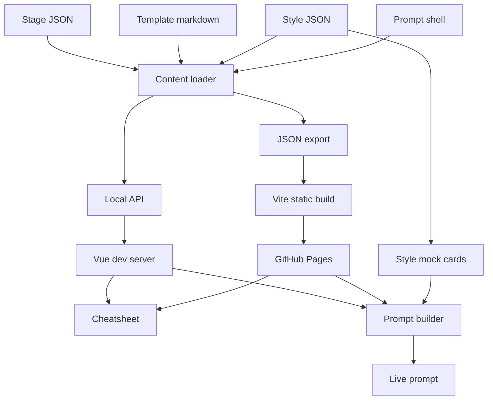

# Architecture

Vue cheatsheet and prompt builder in the browser. ASP.NET Core minimal API on the machine where content is edited. GitHub Pages serves the static build.

The page has two views, and the header always offers both:

- **Cheatsheet.** Six stages, their documents, and a project-run tracker.
- **Prompt builder.** The headline tool. A decision tree through the same six stages. Choices are content data. The live preview is one prompt for Cursor. At Design, visual options render as HTML and CSS mock cards from `content/styles/`.



The diagram uses the [Mermaid fence GitHub renders](https://docs.github.com/en/get-started/writing-on-github/working-with-advanced-formatting/creating-diagrams). One loader reads every content file. The local API and the JSON export are its two outputs. Both views run against either output, so the published prompt builder and the local one assemble the same text.

## Decisions

1. **Content is the source of truth.** Stages, template indexes, styles, and the prompt shell live under `content/` and `templates/`. The Vue app does not import those files. A new option or a new style is a JSON edit. Schema: [content-model.md](content-model.md).

2. **The prompt is assembled in the browser.** The builder walks the saved choices, looks up each `promptFragment`, and fills the shell. No model call and no API key. Cursor is where the prompt runs. Assembly rules are in the content model. Interaction rules are in [ui-rules.md](ui-rules.md).

3. **Visual options are data too.** An option group with `presentation: "visual"` and `optionsFrom: "styles"` expands every `content/styles/*.json` file into a choice. The shared mock card reads that file's `tokens`. The Design style picker is that group. The catalog is the 20 styles listed in the content model.

4. **Publish a static Vite build. Keep the C# API local.** [GitHub Pages](https://docs.github.com/en/pages/getting-started-with-github-pages/what-is-github-pages) takes HTML, CSS, and JavaScript from a repository. [Creating a site](https://docs.github.com/en/pages/getting-started-with-github-pages/creating-a-github-pages-site) states that Pages publishes static files and does not support server-side languages such as PHP, Ruby, or Python. There is no ASP.NET Core process on Pages. The cheatsheet and the builder are read-only over content that changes when the repo changes, so a build-time export is enough for readers. The API stays for local and dev use, where a bad file should fail at startup.

5. **Hash routing.** [Vue Router's hash mode](https://router.vuejs.org/guide/essentials/history-mode.html) is not sent to the server, so a refresh of `#/prompt/design` still returns `index.html`. HTML5 history would need a rewrite to `index.html` for `/prompt/design`, and Pages does not provide one. Create the router with `createWebHashHistory(import.meta.env.BASE_URL)`.

6. **Project-site base path.** A project site is served at `https://<owner>.github.io/<repository>/`. This repository is `SDLC`, so the production build uses `vite build --base=/SDLC/` ([public base path](https://vite.dev/guide/build.html)). Dev keeps base `/`. Fetches for exported JSON use `import.meta.env.BASE_URL`, which is replaced at build time. If the live path ever differs, change `base` and leave component code alone.

7. **.NET 8, pending one confirmation.** The backlog pins .NET 8 minimal APIs ([overview](https://learn.microsoft.com/en-us/aspnet/core/fundamentals/minimal-apis/overview?view=aspnetcore-8.0)). Support ends 10 November 2026; .NET 10 LTS is supported until 14 November 2028 ([policy](https://dotnet.microsoft.com/en-us/platform/support/policy/dotnet-core)). The scaffold waits for the answer in [intent.md](../intent.md). This spec does not silently retarget.

## How the web app reads content

| | List stages | One stage | One template | Styles | Prompt shell |
| --- | --- | --- | --- | --- | --- |
| Dev (`import.meta.env.DEV`) | `/api/stages` | `/api/stages/{id}` | `/api/templates/{id}` | `/api/styles` | `/api/prompt` |
| Pages | `{BASE_URL}data/stages.json` | `{BASE_URL}data/stages/{id}.json` | `{BASE_URL}data/templates/{id}.json` | `{BASE_URL}data/styles.json` | `{BASE_URL}data/prompt.json` |

The JSON shape is the same on both rows ([api-conventions.md](api-conventions.md)). Dev reads the API. When the API is down, the page shows the red error from [ui-rules.md](ui-rules.md).

Vite proxies `/api` to `http://localhost:5080` ([server proxy](https://vite.dev/config/server-options.html#server-proxy)). The API also allows the Vite origin through a Development-only CORS policy, for a browser pointed straight at Kestrel.

Export, run before `vite build`:

```text
dotnet run --project api -- export web/public/data
```

Vite copies `public/` into `dist/` as-is ([public directory](https://vite.dev/guide/assets.html#the-public-directory)). The Pages workflow uploads `web/dist`. That workflow file is a later change; this document is the contract for it. Publish with a [GitHub Actions workflow](https://docs.github.com/en/pages/getting-started-with-github-pages/configuring-a-publishing-source-for-your-github-pages-site) that deploys the Vite artifact. Pages would otherwise run Jekyll against the repository root.

## Prompt builder

Route `#/prompt` and `#/prompt/{stageId}`.

The questions for the current stage fill the work region. The assembled prompt fills the detail region, half the page, with the same slider as the cheatsheet. At 540px the prompt is the bottom sheet.

Assembly is local:

1. Load stages (groups already expanded) and the prompt shell.
2. Read choices from the URL parameter `c` when it is present, otherwise from `localStorage` key `sdlc.prompt`.
3. For each stage in `order`, skip it when it is in `skippedStages` or when nothing is selected.
4. Emit the stage template with that stage's fragments joined by a blank line.
5. Append starter-file lines when a selected option names a template id.

Copy, download (`sdlc-prompt.md`), reset, and share use the feedback rules in [ui-rules.md](ui-rules.md). Share copies the URL. The `c` parameter is `encodeURIComponent` of the saved JSON. A `c` value that does not parse shows the red error and leaves stored choices as they were.

The Design stage's visual group is the style picker. Cards render from `preview.tokens` on the expanded options. Choosing a card selects that option; the fragment added to the prompt is the style's `promptFragment`.

## Repository layout

```text
intent.md
AGENTS.md
README.md
docs/                  rules in this folder
templates/             blanks people copy
content/stages/        one JSON file per stage, including option groups
content/templates/     id, name, stage, file
content/styles/        one JSON file per style, plus order.json
content/prompt/        shell.md and stage.md
web/                   Vue 3 + TypeScript + Vite
api/                   Sdlc.Api, minimal APIs
tests/Sdlc.Api.Tests/  xUnit
SDLC.sln
```

This change adds `intent.md`, `AGENTS.md`, `README.md`, `docs/`, and `templates/`. `content/`, `web/`, `api/`, and `tests/` arrive later, following this layout.

## API surface

`GET /api/stages`, `GET /api/stages/{id}`, `GET /api/templates/{id}`, `GET /api/styles`, `GET /api/styles/{id}`, `GET /api/prompt`.

Startup validation covers stages, templates, styles, and the prompt shell. Failure exits non-zero. Details: [api-conventions.md](api-conventions.md).

## M2 sequence

The build order after this plan is accepted:

1. Scaffold `web/`, `api/`, `SDLC.sln`, `.editorconfig`, and `.gitignore`. Confirm the .NET pin first.
2. Stage content, including option groups and the prompt shell.
3. Prompt builder UI, reading that content, with copy, download, reset, URL, and keyboard use at 540px.
4. Visual style picker: the 20 style files and the mock cards, wired as the Design visual group.
5. C# API and the export, including styles and the prompt shell. The builder then uses `/api` in dev.
6. Cheatsheet overview, detail panel, template viewer.
7. Shared interaction pass for anything the builder has not already covered (favicon, double-click on cards, `?` overlay on the cheatsheet).
8. Project-run tracker.

## What this change does not build

No Vue components, no C# project, no `content/` JSON, no workflow file. Those are the sequence above.
