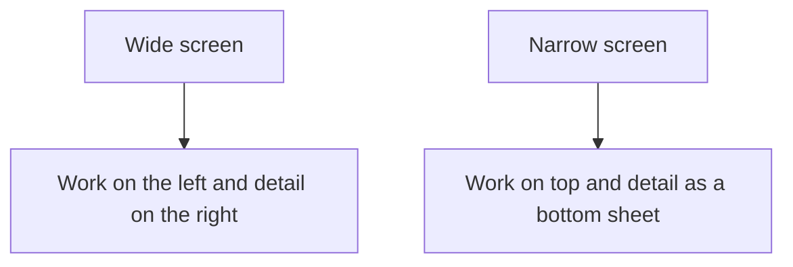

# UI rules

Layout, theme, and interaction for the cheatsheet and the prompt builder. Tokens and schema are in [content-model.md](content-model.md). Official behavior for storage, clipboard, and motion is in [references.md](references.md).

## Chrome

The application chrome is dark. Style mock cards are previews inside the prompt builder. Selecting a style does not change the chrome.

Set `color-scheme: dark` on `:root` ([`color-scheme`](https://developer.mozilla.org/en-US/docs/Web/CSS/Reference/Properties/color-scheme)).

Font: `system-ui, sans-serif`. No webfont request.

| Token | Value | Use |
| --- | --- | --- |
| `--bg` | `#12141a` | Page background |
| `--surface` | `#1c1f27` | Cards, sheet, preview |
| `--text` | `#e8eaef` | Primary text. 15.3:1 on `--bg`, 13.7:1 on `--surface` |
| `--muted` | `#b4b8c4` | Secondary text. 9.3:1 on `--bg`, 8.3:1 on `--surface` |
| `--line` | `#2e3340` | Borders |
| `--accent` | `#8eb6ff` | Links, focus, selection. 9.0:1 on `--bg` |
| `--danger` | `#ff6b6b` | Error text. 6.6:1 on `--bg`, 5.9:1 on `--surface` |
| `--ok` | `#6dcc8a` | Success text. 9.3:1 on `--bg` |

Ratios are for the hex pairs above, against [WCAG 2.2 contrast (minimum)](https://www.w3.org/WAI/WCAG22/Understanding/contrast-minimum.html) (4.5:1 for body text). Links are underlined as well as colored. Errors include the word "Error". Success includes the word "Copied" or "Downloaded".

Focus: `outline: 2px solid var(--accent); outline-offset: 2px`. Do not remove the outline without that replacement.

## Layout

Two regions on every main screen: the work (stage list, or prompt questions) and the detail (stage panel, or live prompt).

- Breakpoint: 960px. At 540px the page is narrow. At 1440px it is wide.
- Default split is half the page. The panel-size slider moves the detail region's share between 30% and 70%.
- Wide (viewport ≥ 960px): detail is the right column. Work is the left column.
- Narrow (< 960px): work is on top and scrolls. Detail is a bottom sheet whose height is that same share of the viewport.
- The sheet does not cover the work. Esc closes an overlay first; it does not unmount the sheet.
- No horizontal scrolling at 540px.



Header, always visible, including at 540px:

- The name SDLC.
- Two links: Cheatsheet (`#/`) and Prompt (`#/prompt`). The current one is `aria-current="page"`.

Cheatsheet routes: `#/`, `#/stages/{id}`, `#/templates/{id}`.
Prompt routes: `#/prompt`, `#/prompt/{stageId}`.

Use `createWebHashHistory` so those paths survive a refresh on static hosting. See [architecture.md](architecture.md).

## Sliders

Both are `<input type="range">` with a visible label.

| Key | Default | Range | Affects |
| --- | --- | --- | --- |
| `sdlc.panelRatio` | `0.5` | 0.3–0.7 | Detail width when wide, detail height when narrow |
| `sdlc.cardScale` | `1` | 0.85–1.25 | Stage-card padding and type, and style-mock type |

Write through to CSS variables `--panel-ratio` and `--card-scale` on input. Persist the number in [`localStorage`](https://developer.mozilla.org/en-US/docs/Web/API/Window/localStorage) on input. On load, use the stored value when it parses and falls inside the range; otherwise use the default.

Animate the split with a 200ms ease-out transition on the property that changes. Under `prefers-reduced-motion: reduce`, set that transition to `none`.

If `localStorage` throws, keep the defaults for the session and show the red error once.

Card scale uses `calc(var(--card-scale) * <base>)` on padding and font-size. Do not scale cards with `transform`; that skips layout and clips at 540px.

## Cheatsheet

- Stage cards in `order`. Each card shows the name, the one-liner, and the key artifact.
- The detail region is always present. With no selection it says "Select a stage."
- Selecting a card sets the route to `#/stages/{id}` and shows tabs: Steps, Done-checks, Pitfalls, Documents.
- Documents lists that stage's templates and opens `#/templates/{id}`.
- Tabs use the arrow keys while focus is on a tab. Those arrows do not change the stage.

## Copy, download, and errors

Copy uses [`navigator.clipboard.writeText`](https://developer.mozilla.org/en-US/docs/Web/API/Clipboard/writeText). It needs a [secure context](https://developer.mozilla.org/en-US/docs/Web/Security/Defenses/Secure_Contexts). Localhost and GitHub Pages are secure contexts. Do not add a second copy path. If the promise rejects, show the failure.

| Gesture | Plain text |
| --- | --- |
| Double-click a stage card | Name, blank line, one-liner, blank line, `Key artifact: …` |
| Double-click a step | Title, blank line, step text |
| Copy on the template viewer | The template markdown |
| Copy on the prompt builder | The assembled prompt |
| Share on the prompt builder | The page URL |

Double-click copies a stage card or a step. Sliders, buttons, and the preview keep their ordinary pointer behavior.

Success: a tick badge on the element (includes the word "Copied" for assistive tech) and a toast. The badge clears after 2s. The toast clears after 3s. One toast at a time; a new toast replaces the old one.

Failure: the toast uses `--danger` text on `--surface`, starts with "Error", and includes `error.message` when the browser provides one. The tick does not appear.

Download writes a `Blob` of the markdown and triggers a download named `{id}.md` for a template and `sdlc-prompt.md` for the prompt. Success toast: "Downloaded". Failure uses the same red error.

Toasts sit at the top center, so the bottom sheet cannot cover them. The toast region is `role="status"` for success and `role="alert"` for errors.

Template markdown is rendered with raw HTML disabled ([markdown-it](https://markdown-it.github.io/), `html: false`).

## Keyboard

Ignore shortcuts while focus is in an input, textarea, select, or contenteditable, except Esc.

| Key | Cheatsheet | Prompt builder |
| --- | --- | --- |
| `?` | Toggle the shortcut overlay | Same |
| Esc | Close the overlay, then a template view, back to the stage | Close the overlay |
| 1–6 | Select that stage by `order` | Open that stage's questions |
| ArrowLeft, ArrowUp | Previous stage | Previous option in the focused group |
| ArrowRight, ArrowDown | Next stage | Next option in the focused group |
| Enter or Space | Select the focused card | Toggle the focused option. On a single-select group, select it. |
| Home / End | First / last stage | First / last option in the group |

Arrows stop at the ends.

The overlay is a `dialog` with `aria-modal="true"`. It lists every shortcut for the current view. Focus moves into it and returns to the previous element on close. `?` and Esc close it. While it is open, the other shortcuts do nothing.

## Prompt builder

Questions for one stage at a time. A stepper shows all six stage names; at 540px it may collapse to the numbers 1–6 plus the current name.

- A text group is a list of choices. Single-select is a radio group. Multi-select is a checkbox group. Each row shows `label` and `detail`.
- A skippable group (`required: false`) has a Skip control that clears it.
- Skip stage clears every group in the stage and marks the stage skipped.
- The detail region is the live prompt, updated on each change. It is a `pre` with an accessible name "Assembled prompt". Do not put `aria-live` on the preview; the toast is the announcement.
- A line under the stepper counts required groups still open, for example "2 choices left". Skipping a stage clears that stage's remaining count.
- Reset clears saved choices and the `c` query parameter, and restores defaults.
- The same Copy, Download, and error rules as the rest of the page apply. Share copies the URL.

Saved choices and the URL shape are in [content-model.md](content-model.md).

## Style mock cards

One card component for every style. The card reads CSS variables from the style's `tokens`. Adding a style does not add a component.

Fixed sample copy, so the cards differ by CSS:

- Kicker: the style name
- Title: "The quick look"
- Body: "A sentence of body text."
- Button label: "Action"

```html
<article class="mock">
  <div class="mock-card">
    <p class="mock-kicker">Glassmorphism</p>
    <h3>The quick look</h3>
    <p>A sentence of body text.</p>
    <button type="button">Action</button>
  </div>
</article>
```

The component sets `--mock-bg`, `--mock-surface`, `--mock-text`, `--mock-muted`, `--mock-accent`, `--mock-border`, `--mock-radius`, `--mock-shadow`, `--mock-font`, and `--mock-backdrop` from `tokens`. The card uses those variables for background, color, font, border, radius, shadow, and `backdrop-filter`. Token meanings are in [content-model.md](content-model.md).

At 540px the cards are one column. From 720px of questions-pane width, two columns. The selected card has a 2px `--accent` outline and `aria-pressed="true"`. Multi-select allows more than one.

`bestFor` sits under the card in chrome text (`--muted` on `--surface`), so it stays readable when the mock itself is decorative.

## Favicon

Inline SVG via a data URI on `<link rel="icon">`. No extra request. Encode `#` as `%23`.

```svg
<svg xmlns="http://www.w3.org/2000/svg" viewBox="0 0 32 32">
  <rect width="32" height="32" rx="7" fill="#12141a"/>
  <circle cx="16" cy="16" r="8" fill="none" stroke="#8eb6ff" stroke-width="2"/>
  <circle cx="16" cy="8" r="2.2" fill="#e8eaef"/>
</svg>
```

```html
<link rel="icon" href="data:image/svg+xml,<svg xmlns='http://www.w3.org/2000/svg' viewBox='0 0 32 32'><rect width='32' height='32' rx='7' fill='%2312141a'/><circle cx='16' cy='16' r='8' fill='none' stroke='%238eb6ff' stroke-width='2'/><circle cx='16' cy='8' r='2.2' fill='%23e8eaef'/></svg>">
```

The mark is a ring with a start dot: the lifecycle, on the same dark ground as the chrome.

## Project runs

The later project tracker stores runs under `sdlc.runs`. The record shape is in [content-model.md](content-model.md). Slider keys and `sdlc.prompt` stay separate from runs.
